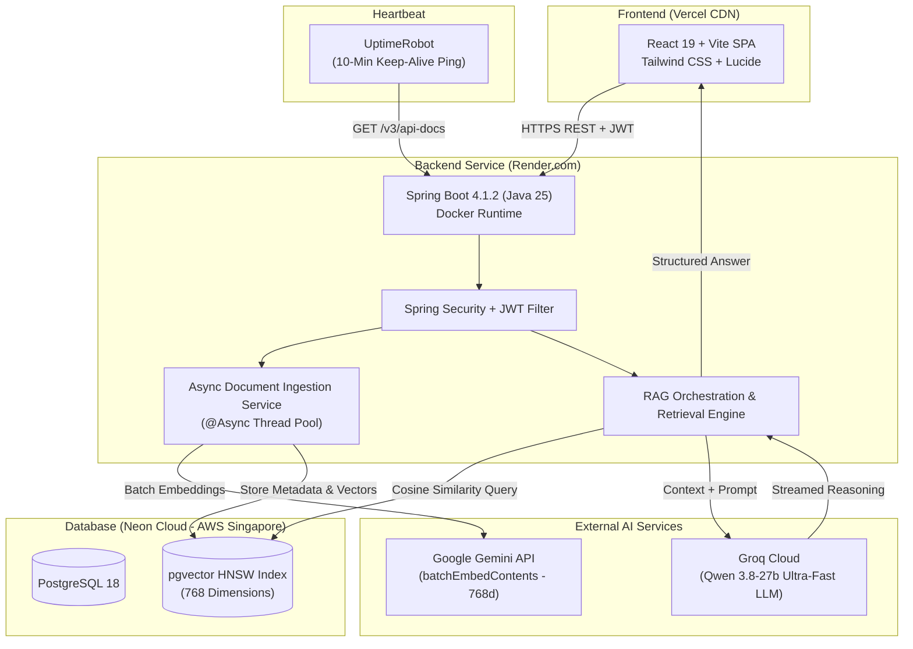

# 🧠 DocuMind AI — Enterprise Document Intelligence & Semantic RAG Platform

<p align="center">
  
  
  
  
  
  
</p>

<p align="center">
  A production-ready, multi-tenant <strong>Retrieval-Augmented Generation (RAG)</strong> platform designed to ingest enterprise documents (PDF, DOCX, TXT, MD), index them using vector embeddings into <strong>PostgreSQL (pgvector)</strong>, and generate high-precision, hallucination-resistant answers with clickable source citations, executive summaries, and LaTeX mathematical rendering.
</p>

<p align="center">
  <a href="https://docu-mind-ai-phi-cyan.vercel.app/"><strong>🌐 Live Application</strong></a> •
  <a href="https://docu-mind-ai-l4nr.onrender.com/v3/api-docs"><strong>📖 API Documentation</strong></a> •
  <a href="#-architecture"><strong>📐 System Architecture</strong></a> •
  <a href="#-getting-started"><strong>🚀 Getting Started</strong></a>
</p>

---

## 🌟 Highlights & Key Features

- **⚡ Async Non-Blocking Ingestion:** Multipart document uploads return in under **~150ms** with status `PROCESSING`. Document parsing, chunking, and embedding occur asynchronously in the background (`@Async`) while the UI polls dynamically.
- **🛡️ Free-Tier Quota Guardrail Engine:** Implemented Google Gemini `batchEmbedContents` (batches of 50 chunks per API call) with adaptive 800ms pacing and a 500-chunk document guardrail, eliminating `429 Too Many Requests` quota exhaustion.
- **🔍 High-Performance Vector Similarity:** Powered by **pgvector (v0.8.6)** on **Neon Cloud** with HNSW indexing and Cosine Distance matching for sub-millisecond similarity retrieval.
- **🤖 Dual-AI Hybrid Pipeline:**
  - **Embeddings:** Google Gemini `text-embedding-004` (768 dimensions).
  - **Chat Reasoning:** Groq-accelerated `qwen/qwen3.8-27b` providing low-latency generation.
- **🎨 Modern Dark UI:** Crafted with **React 19**, **TypeScript**, and **Tailwind CSS**. Features custom KaTeX math rendering, glowing neon status indicators, and executive blockquote cards.
- **🔐 Enterprise-Grade Security:** Stateless **JWT Authentication**, BCrypt password hashing, role-based endpoint protection (RBAC), and dynamic CORS whitelist configuration.
- **⏱️ 24/7 Zero Cold-Start Reliability:** Continuous keep-alive heartbeat via **UptimeRobot** preventing cloud container sleep on Render free tier.

---

## 📐 System Architecture



---

## 🛠️ Tech Stack & Engineering Specifications

| Domain | Technology / Library | Description |
| :--- | :--- | :--- |
| **Backend Framework** | Spring Boot 4.1.2 | Enterprise microservice runtime |
| **Language** | Java 25 (OpenJDK) | Utilizing latest JVM performance enhancements |
| **AI Integration** | Spring AI 2.0.1 | Vector store abstraction & model orchestration |
| **Primary Database** | PostgreSQL 18.6 | Hosted on Neon Cloud (Serverless) |
| **Vector Engine** | pgvector 0.8.6 | HNSW cosine similarity index (768 dimensions) |
| **Frontend Framework**| React 19 + TypeScript | High-performance reactive Single Page App |
| **Bundler & Build** | Vite 8 + Rolldown | Blazing fast client asset compilation |
| **Styling** | Tailwind CSS v4 | Futuristic dark glassmorphic design system |
| **Containerization** | Docker | Multi-stage build (`eclipse-temurin:25-jre`) |
| **Hosting & Cloud** | Render + Vercel + Neon | Globally distributed serverless deployment |

---

## 📁 Repository Structure

```
docu-mind-ai/
├── docu-mind-ai-backend/           # Spring Boot 4 (Java 25) REST API
│   ├── src/main/java/com/documind/
│   │   ├── config/                # AiConfig, SecurityConfig, CorsConfig
│   │   ├── controller/            # Auth, Document, Chat, Search Controllers
│   │   ├── dto/                   # Request/Response records
│   │   ├── entity/                # JPA Entities (User, DocumentMetadata)
│   │   ├── repository/            # Spring Data Repositories
│   │   ├── service/               # Document Parsing, Ingestion, RAG Services
│   │   └── filter/                # JWT Authentication Filter
│   ├── src/main/resources/
│   │   ├── application.yaml       # Profile router
│   │   ├── application-dev.yml    # Local development config
│   │   └── application-prod.yml   # Production Cloud configuration
│   ├── Dockerfile                 # Multi-stage container build
│   └── pom.xml
│
├── docu-mind-ai-frontend/          # React 19 + Vite + Tailwind Client
│   ├── src/
│   │   ├── components/            # ChatWindow, UploadModal, Navbar, Sidebar
│   │   ├── context/               # AuthContext, ChatContext
│   │   ├── hooks/                 # useDocuments, useChat
│   │   ├── pages/                 # Dashboard, Chat, Documents, Search, Login
│   │   └── services/              # Axios API clients
│   ├── vercel.json                # Single Page App routing configuration
│   └── package.json
│
└── README.md                      # Root documentation
```

---

## 🚀 Getting Started (Local Development)

### Prerequisites

- **Java 25** JDK installed ([Adoptium Temurin](https://adoptium.net/))
- **Node.js 20+** and `npm`
- **PostgreSQL** with `pgvector` extension enabled
- **API Keys**:
  - [Google AI Studio](https://aistudio.google.com/) (Gemini API Key)
  - [Groq Console](https://console.groq.com/) (Groq API Key)

---

### 1. Database Setup

Create a PostgreSQL database and enable `vector`:

```sql
CREATE DATABASE documind;
\c documind;
CREATE EXTENSION IF NOT EXISTS vector;
```

---

### 2. Backend Setup

```bash
cd docu-mind-ai-backend

# Set environment variables (or configure in application-dev.yml)
export GROQ_API_KEY="your-groq-key"
export GEMINI_API_KEY="your-gemini-key"
export JWT_SECRET="your-256-bit-jwt-secret-string"

# Build and run
./mvnw clean spring-boot:run
```

The backend starts at `http://localhost:8080`. Swagger UI is accessible at `http://localhost:8080/swagger-ui.html`.

---

### 3. Frontend Setup

```bash
cd docu-mind-ai-frontend

# Install dependencies
npm install

# Start development server
npm run dev
```

The frontend launches at `http://localhost:5173`.

---

## 🔒 Environment Variables Reference

### Backend (`application-prod.yml`)

| Variable | Description | Default / Example |
| :--- | :--- | :--- |
| `SPRING_PROFILES_ACTIVE` | Active Spring profile | `prod` |
| `SPRING_DATASOURCE_URL` | PostgreSQL JDBC connection URL | `jdbc:postgresql://host:5432/documind?sslmode=require` |
| `SPRING_DATASOURCE_USERNAME` | Database username | `neondb_owner` |
| `SPRING_DATASOURCE_PASSWORD` | Database password | `********` |
| `GROQ_API_KEY` | Groq LLM API Key | `gsk_...` |
| `GEMINI_API_KEY` | Google Gemini Embedding API Key | `AIzaSy...` |
| `JWT_SECRET` | Secret key for signing JWT tokens | `min-64-character-secret` |
| `PORT` | Web server port (Render injected) | `8080` / `10000` |

### Frontend (`.env`)

| Variable | Description | Example |
| :--- | :--- | :--- |
| `VITE_API_BASE_URL` | Backend API base URL | `https://docu-mind-ai-l4nr.onrender.com` |

---

## 📡 Core API Endpoints

| Method | Endpoint | Access | Description |
| :--- | :--- | :--- | :--- |
| `POST` | `/api/v1/auth/register` | Public | Register new user account |
| `POST` | `/api/v1/auth/login` | Public | Authenticate user & issue JWT |
| `POST` | `/api/v1/documents/upload` | Authenticated | Upload document & initiate async ingestion |
| `GET` | `/api/v1/documents` | Authenticated | List all user-owned documents |
| `GET` | `/api/v1/documents/{id}` | Authenticated | Get document status & metadata |
| `DELETE` | `/api/v1/documents/{id}` | Authenticated | Delete document & associated vector chunks |
| `POST` | `/api/v1/chat` | Authenticated | RAG conversational query against documents |
| `POST` | `/api/v1/search/similarity` | Authenticated | Direct vector similarity search with threshold |

---

## 🛡️ Production Deployment Architecture

- **Backend:** Packaged via multi-stage Docker build running under an unprivileged `spring:spring` user. Deployed on **Render.com** (Southeast Asia - Singapore).
- **Frontend:** Built with Vite and hosted on **Vercel** with edge rewrites handling client-side routing.
- **Database:** Serverless PostgreSQL 18 with `pgvector` hosted on **Neon.tech** (ap-southeast-1).
- **Uptime Assurance:** Configured **UptimeRobot** polling `/v3/api-docs` on an interval schedule to guarantee zero cold starts.

---

## 👨‍💻 Author

**Sagar Sharma**
- GitHub: [@Sagar-devx](https://github.com/Sagar-devx)
- Project Repository: [docu-mind-ai](https://github.com/Sagar-devx/docu-mind-ai)

---

<p align="center">
  ⭐ If you find this project helpful or inspiring, please consider starring the repository!
</p>
