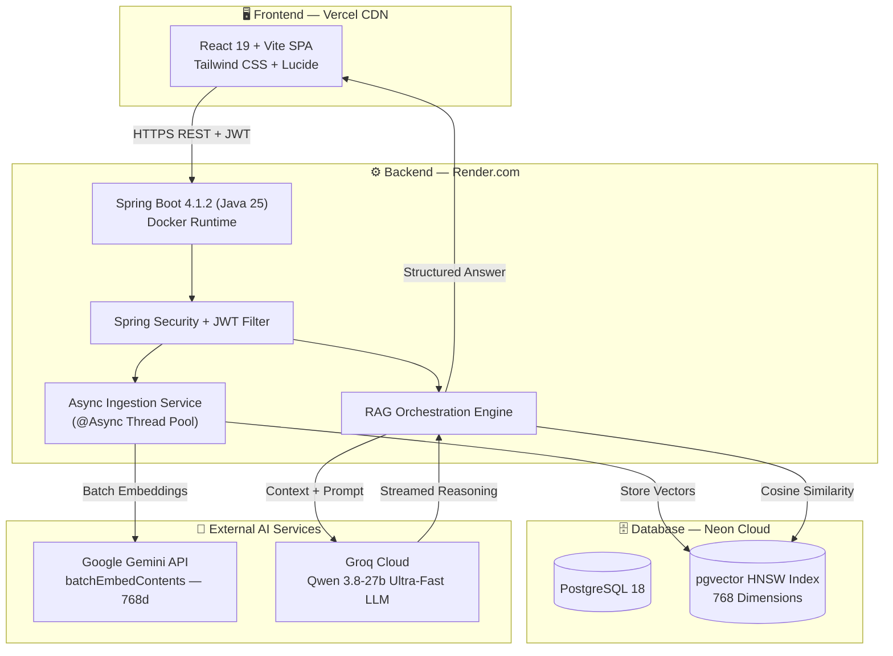
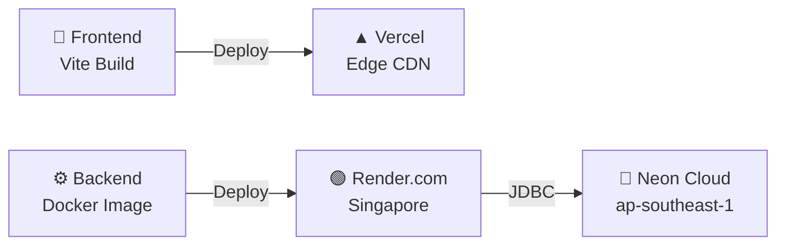

<div align="center">

# 🧠 DocuMind AI
### Enterprise Document Intelligence & Semantic RAG Platform

<br/>

<!-- Action Badges -->
<a href="https://docu-mind-ai-phi-cyan.vercel.app/" target="_blank">
  
</a>
<a href="https://docu-mind-ai-l4nr.onrender.com/swagger-ui/index.html" target="_blank">
  
</a>

<br/><br/>

<!-- Tech Badges -->


<br/><br/>

> **A production-ready, multi-tenant Retrieval-Augmented Generation (RAG) platform** that ingests enterprise documents (PDF, DOCX, TXT, MD), indexes them using vector embeddings into **PostgreSQL (pgvector)**, and generates high-precision, hallucination-resistant answers with clickable source citations, executive summaries, and LaTeX mathematical rendering.

<br/>

[🌐 Live Application](https://docu-mind-ai-phi-cyan.vercel.app/) · [📖 API Documentation](https://docu-mind-ai-l4nr.onrender.com/swagger-ui/index.html) · [📐 System Architecture](#-system-architecture) · [🚀 Getting Started](#-getting-started-local-development)

</div>

<br/>

---

## ✨ Feature Highlights

<table>
<tr>
<td width="50%" valign="top">

### ⚡ Async Non-Blocking Ingestion
Multipart uploads return in **~150ms** with `PROCESSING` status. Parsing, chunking & embedding run asynchronously via `@Async` thread pools while the UI polls dynamically.

</td>
<td width="50%" valign="top">

### 🛡️ Free-Tier Quota Guardrails
Google Gemini `batchEmbedContents` (50 chunks/batch) with adaptive **800ms pacing** and a **500-chunk** document guardrail — zero `429` errors.

</td>
</tr>
<tr>
<td width="50%" valign="top">

### 🔍 Vector Similarity Search
Powered by **pgvector v0.8.6** on **Neon Cloud** with HNSW indexing and Cosine Distance for sub-millisecond similarity retrieval.

</td>
<td width="50%" valign="top">

### 🤖 Dual-AI Hybrid Pipeline
**Embeddings →** Gemini `text-embedding-004` (768d)  
**Reasoning →** Groq-accelerated `qwen3.8-27b` for low-latency generation.

</td>
</tr>
<tr>
<td width="50%" valign="top">

### 🎨 Modern Dark UI
**React 19 + TypeScript + Tailwind CSS** with custom KaTeX math rendering, glowing neon status indicators, and executive blockquote cards.

</td>
<td width="50%" valign="top">

### 🔐 Enterprise-Grade Security
Stateless **JWT Authentication**, BCrypt hashing, role-based endpoint protection (RBAC), and dynamic CORS whitelisting.

</td>
</tr>
</table>

---

## 📐 System Architecture



---

## 🛠️ Tech Stack

<div align="center">

| Layer | Technology | Purpose |
| :---: | :--- | :--- |
| 🏗️ **Backend** | Spring Boot 4.1.2 · Java 25 | Enterprise microservice runtime |
| 🧠 **AI Layer** | Spring AI 2.0.1 | Vector store abstraction & model orchestration |
| 🗄️ **Database** | PostgreSQL 18.6 (Neon Cloud) | Serverless relational storage |
| 📊 **Vectors** | pgvector 0.8.6 | HNSW cosine similarity (768 dimensions) |
| 🖥️ **Frontend** | React 19 · TypeScript · Vite 8 | High-performance reactive SPA |
| 🎨 **Styling** | Tailwind CSS v4 | Futuristic dark glassmorphic design |
| 🐳 **Container** | Docker (`eclipse-temurin:25-jre`) | Multi-stage production build |
| ☁️ **Hosting** | Render + Vercel + Neon | Globally distributed deployment |

</div>

---

## 📁 Project Structure

```
docu-mind-ai/
│
├── 📦 docu-mind-ai-backend/            # Spring Boot 4 (Java 25) REST API
│   ├── src/main/java/com/documind/
│   │   ├── config/                     # AiConfig, SecurityConfig, CorsConfig
│   │   ├── controller/                 # Auth, Document, Chat, Search Controllers
│   │   ├── dto/                        # Request/Response records
│   │   ├── entity/                     # JPA Entities (User, DocumentMetadata)
│   │   ├── repository/                 # Spring Data Repositories
│   │   ├── service/                    # Document Parsing, Ingestion, RAG Services
│   │   └── filter/                     # JWT Authentication Filter
│   ├── src/main/resources/
│   │   ├── application.yaml            # Profile router
│   │   ├── application-dev.yml         # Local development config
│   │   └── application-prod.yml        # Production configuration
│   ├── Dockerfile                      # Multi-stage container build
│   └── pom.xml
│
├── 🎨 docu-mind-ai-frontend/           # React 19 + Vite + Tailwind Client
│   ├── src/
│   │   ├── components/                 # ChatWindow, UploadModal, Navbar, Sidebar
│   │   ├── context/                    # AuthContext, ChatContext
│   │   ├── hooks/                      # useDocuments, useChat
│   │   ├── pages/                      # Dashboard, Chat, Documents, Search, Login
│   │   └── services/                   # Axios API clients
│   ├── vercel.json                     # SPA routing configuration
│   └── package.json
│
└── 📄 README.md
```

---

## 🚀 Getting Started (Local Development)

### Prerequisites

| Requirement | Version | Link |
| :--- | :--- | :--- |
| Java JDK | 25+ | [Adoptium Temurin](https://adoptium.net/) |
| Node.js | 20+ | [nodejs.org](https://nodejs.org/) |
| PostgreSQL | 16+ with `pgvector` | [postgresql.org](https://www.postgresql.org/) |
| Groq API Key | — | [Groq Console](https://console.groq.com/) |
| Gemini API Key | — | [Google AI Studio](https://aistudio.google.com/) |

<br/>

### 1️⃣ Database Setup

```sql
CREATE DATABASE documind;
\c documind;
CREATE EXTENSION IF NOT EXISTS vector;
```

### 2️⃣ Backend Setup

```bash
cd docu-mind-ai-backend

# Set environment variables (or configure in application-dev.yml)
export GROQ_API_KEY="your-groq-key"
export GEMINI_API_KEY="your-gemini-key"
export JWT_SECRET="your-256-bit-jwt-secret-string"

# Build and run
./mvnw clean spring-boot:run
```

> **Backend** starts at `http://localhost:8080`  
> **Swagger UI** at `http://localhost:8080/swagger-ui.html`

### 3️⃣ Frontend Setup

```bash
cd docu-mind-ai-frontend

npm install
npm run dev
```

> **Frontend** launches at `http://localhost:5173`

---

## 🔒 Environment Variables

<details>
<summary><strong>Backend — <code>application-prod.yml</code></strong></summary>

<br/>

| Variable | Description | Example |
| :--- | :--- | :--- |
| `SPRING_PROFILES_ACTIVE` | Active Spring profile | `prod` |
| `SPRING_DATASOURCE_URL` | PostgreSQL JDBC URL | `jdbc:postgresql://host:5432/documind?sslmode=require` |
| `SPRING_DATASOURCE_USERNAME` | Database username | `neondb_owner` |
| `SPRING_DATASOURCE_PASSWORD` | Database password | `••••••••` |
| `GROQ_API_KEY` | Groq LLM API Key | `gsk_...` |
| `GEMINI_API_KEY` | Google Gemini API Key | `AIzaSy...` |
| `JWT_SECRET` | JWT signing secret | `min-64-character-secret` |
| `PORT` | Server port (Render injected) | `8080` / `10000` |

</details>

<details>
<summary><strong>Frontend — <code>.env</code></strong></summary>

<br/>

| Variable | Description | Example |
| :--- | :--- | :--- |
| `VITE_API_BASE_URL` | Backend API base URL | `https://docu-mind-ai-l4nr.onrender.com` |

</details>

---

## 📡 Core API Endpoints

| Method | Endpoint | Auth | Description |
| :---: | :--- | :---: | :--- |
| `POST` | `/api/v1/auth/register` | 🔓 | Register new user account |
| `POST` | `/api/v1/auth/login` | 🔓 | Authenticate & issue JWT |
| `POST` | `/api/v1/documents/upload` | 🔒 | Upload document & start async ingestion |
| `GET` | `/api/v1/documents` | 🔒 | List all user-owned documents |
| `GET` | `/api/v1/documents/{id}` | 🔒 | Get document status & metadata |
| `DELETE` | `/api/v1/documents/{id}` | 🔒 | Delete document & vector chunks |
| `POST` | `/api/v1/chat` | 🔒 | RAG conversational query |
| `POST` | `/api/v1/search/similarity` | 🔒 | Direct vector similarity search |

---

## 🛡️ Production Deployment



| Component | Platform | Region | Notes |
| :--- | :--- | :--- | :--- |
| **Frontend** | Vercel | Edge (Global) | Vite build + SPA rewrites |
| **Backend** | Render.com | Singapore | Docker, unprivileged `spring:spring` user |
| **Database** | Neon.tech | ap-southeast-1 | Serverless PostgreSQL 18 + pgvector |

---

## 👨‍💻 Author

<div align="center">

**Sagar Sharma**

[](https://github.com/Sagar-devx)
[](https://github.com/Sagar-devx/docu-mind-ai)

</div>

---

<div align="center">

<sub>Built with ❤️ by Sagar Sharma</sub>

</div>
